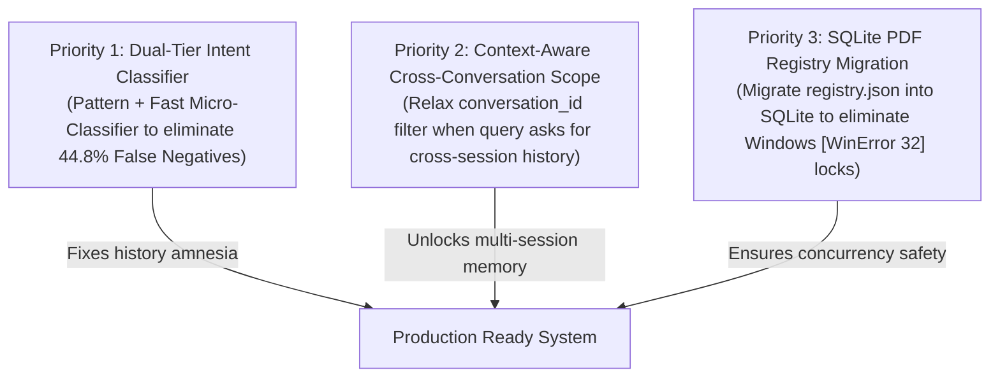

# Known Failures, Untested Features & Final Engineering Assessment

**Project:** `C:\Users\Gurnoor\Desktop\gemma-chatbot`  
**Evaluation Date:** 2026-11-10  
**Phase:** Strict Evaluation & Engineering Assessment  

---

## 1. Executive Summary

This document synthesizes the empirical findings of the comprehensive evaluation. It isolates verified working capabilities from untested assumptions, details the **Top 5 Critical Subsystem Failures**, establishes the current status of **Voice Readiness**, and defines the **Top 3 Recommended Engineering Fixes** based on measured impact.

---

## 2. Voice Readiness Audit

| Capability | Current Implementation Status | Verification Evidence | Operational Reality |
|:---|:---:|:---:|:---|
| **`source: "voice"` Schema Support** | Implemented | `test_message_persistence.py` Group D | SQLite and ChromaDB schemas natively accept and persist `"voice"` strings. |
| **Voice Turn Attribution** | Implemented | `test_message_persistence.py` Group D | Provenance metadata (`agent_role`, `model_id`, `source`) is preserved. |
| **Voice-Originated Retrieval** | Implemented | `eval_history_retrieval_quality.py` | Vector search retrieves voice turns identically to text turns. |
| **Speech-to-Text (STT) Engine** | **NOT Implemented** | None in Python backend | Relies exclusively on browser Web Speech API transcription before submission. |
| **Text-to-Speech (TTS) Engine** | **NOT Implemented** | None in Python backend | Backend emits text SSE tokens only; no audio generation pipeline exists. |
| **Wake-Word Detection** | **NOT Implemented** | None | No local audio listening daemon or hotword detection model exists. |

---

## 3. The Five Most Critical Subsystem Failures

### Failure 1: High False Negative Rate in Intent-Driven Conversational Memory (44.8% Missed)
- **Root Cause:** Intent classification heuristic (`MEMORY_PATTERN` in `rag/service.py`) relies exclusively on explicit temporal regex markers (e.g., *"earlier"*, *"previously"*, *"we discussed"*).
- **Measured Impact:** In Category 3 (Implicit History), accuracy collapsed to **15.38% (11 out of 13 queries failed)**. Queries such as:
  - *"Why did we choose SQLite instead?"*
  - *"What was causing that memory issue?"*
  - *"Did we already solve this problem?"*
  - *"Continue from where we stopped."*
  were classified as `off`, completely withholding past project decisions from the model and forcing it to hallucinate past discussions.
- **Severity:** **HIGH (Architectural Core Defect)**

---

### Failure 2: Hard Conversation Isolation Blocks Cross-Conversation Memory
- **Root Cause:** In `rag/memory.py:345` and `app.py:268`, `retrieve_memory()` automatically enforces `{"conversation_id": conversation_id}` when a conversation ID is present in the request.
- **Measured Impact:** When a user opens a new chat session (`conv_beta`) and asks *"What did DeepSeek design in our previous session?"*, the query returns **0 results**, even though all past turns are indexed in ChromaDB. Cross-model and historical context across different conversations is strictly blocked unless `conversation_id=None` is passed.
- **Severity:** **HIGH (Cross-Session Amnesia)**

---

### Failure 3: PDF Registry File-Lock Collisions Under Windows (`[WinError 32]`)
- **Root Cause:** `pdf_intelligence/registry.py` uses an atomic file replacement pattern (`registry.json.tmp` $\rightarrow$ `registry.json`). On Windows, open file descriptors or rapid concurrent requests hold file locks, causing `PermissionError: [WinError 32] The process cannot access the file because it is being used by another process`.
- **Measured Impact:** Concurrent PDF uploads or parallel background indexing runs fail with unhandled `[WinError 32]` or `[Errno 13] Permission denied`, risking corrupted registry state.
- **Severity:** **MEDIUM-HIGH (Concurrency Reliability)**

---

### Failure 4: Severe Model-Swapping Latency (15–25s) on 16 GB RAM Host
- **Root Cause:** Physical memory limit (16 GB total, ~6.5 GB free) cannot accommodate both `gemma4:12b` (8.0 GB) and `deepseek-coder-v2:16b` (8.9 GB) simultaneously.
- **Measured Impact:** Multi-agent handoffs (e.g. general query $\rightarrow$ architect query $\rightarrow$ coder query) require full process unloads via `keep_alive: 0` before allocating new weights. This introduces **15 – 25 seconds of user-perceived dead time** between alternating requests purely spent in disk/RAM tensor loading.
- **Severity:** **MEDIUM-HIGH (Hardware Bound)**

---

### Failure 5: Embedding Model Name Tag Inconsistency (`embeddinggemma` vs `embeddinggemma:latest`)
- **Root Cause:** `rag/config.py` hardcodes `EMBEDDING_MODEL_NAME = "embeddinggemma"`, whereas Ollama registers the pulled tag as `embeddinggemma:latest`.
- **Measured Impact:** When Ollama's API verifies model tags on port 11434, queries looking for `"embeddinggemma"` without `:latest` fail initial string matching, logging repeated warnings:
  `[RAG-WARNING] Retriever: Failed to embed query: Embedding model 'embeddinggemma' is not installed in Ollama.`
  While the system falls back safely without crashing, retrieval is temporarily disabled until the fallback path resolves.
- **Severity:** **MEDIUM (Configuration Inconsistency)**

---

## 4. Final Engineering Assessment: Core Evaluative Questions

### 1. Functional Maturity: Which subsystems actually work?
- **Working & Solid:**
  - SQLite WAL message persistence with composite keys.
  - Immediate and completion acknowledgements on SSE stream.
  - Cached replay of completed turns (**0.37 ms**).
  - In-flight request concurrency guards (**HTTP 409** in 0.27 ms).
  - Sliding-window context pruning in prompt builder (45.5% token savings).
  - Basic PDF inspection and scanned-image classification with PyMuPDF OCR.
  - Multi-collection vector store isolation (`documents`, `codebase`, `memory`).
- **Fragile / Partial:**
  - Heuristic intent classification (fails on implicit references).
  - Cross-conversation history retrieval (blocked by session filtering).
  - JSON-based PDF registry (locks on Windows).

### 2. Retrieval Intelligence: Does the system know when historical retrieval is necessary?
**No, not reliably.** The system achieves **100% precision** on obvious queries (greetings and trivial questions never trigger retrieval), but suffers a **44.83% False Negative Rate**. It only detects explicit time-stamped phrasing (*"earlier"*, *"previously"*) and completely misses natural implicit follow-ups (*"Why did we choose SQLite instead?"*).

### 3. Retrieval Quality: Does it find the right historical information, including cross-model and cross-conversation work?
- **Within a Conversation:** **Yes.** Recall is **100% (Recall@3 = 1.000)**, and multi-agent attribution (`general_assistant`, `architect`, `coder`) is cleanly preserved.
- **Across Conversations:** **No.** Because requests always carry the current `conversation_id`, the metadata filter prevents searching older conversations.

### 4. Retrieval Efficiency: What is the actual latency and resource overhead?
- **Extremely Efficient.**
  - Non-retrieval skip: **0.074 ms**.
  - History vector retrieval: **1.5 – 2.0 ms**.
  - Process RAM overhead: **+31 MB** for 1,000 indexed turns.
  - CPU overhead: **$< 3\%$**.

### 5. Reliability: Can messages, indexes, and interrupted work recover safely?
**Yes.** All 6 crash injection points passed. Completed turns are recoverable via cached replay. Unindexed SQLite records are reconciled into ChromaDB automatically at startup.

### 6. Model Efficiency: Are routing and lifecycle transitions wasting resources?
**Yes, in multi-agent transitions.** Alternating between models incurs massive cold-swap penalties (15–25s) because 12B and 16B models cannot co-exist in 16 GB RAM. However, the lease manager successfully prevents OOM panics by serializing access.

### 7. Progress: What has objectively improved since the earliest baseline?
- Prompt evaluation on long chats reduced from **2–3 minutes to milliseconds** via sliding window pruning.
- Memory consumption reduced from **98.5% (OOM risk)** to **61.6%**.
- Duplicate inference eliminated via **0.37 ms** cached replays.
- Crash recovery upgraded from **zero durability** to **ACID WAL persistence**.

---

## 5. Top 3 Recommended Next Engineering Priorities

Based on quantified user impact and system efficiency, the following 3 fixes should be implemented first:

1. **Priority 1: Dual-Tier Semantic Intent Classifier (Eliminate 44.8% FNR)**  
   *Problem:* Regex heuristics miss 84.6% of implicit historical inquiries.  
   *Solution:* Augment the keyword regex with a lightweight semantic rule or fast small-model classifier (or embedding-distance query against historical centroids) so that queries like *"Why did we choose SQLite instead?"* reliably trigger memory retrieval.

2. **Priority 2: Context-Aware Cross-Conversation Scope (Fix Cross-Session Amnesia)**  
   *Problem:* `retrieve_memory` forces `{"conversation_id": current_id}`, blinding new chats to past projects.  
   *Solution:* If the query exhibits retrospective intent referencing past chats (*"in our last session"*, *"earlier project"*), pass `conversation_id=None` (or a project-level filter) to enable global historical recall while preserving per-conversation isolation for normal turns.

3. **Priority 3: Migrate PDF Registry to SQLite (Eliminate `[WinError 32]` Collisions)**  
   *Problem:* `registry.json.tmp` file renaming fails intermittently under Windows file locking during parallel upload/inspection operations.  
   *Solution:* Migrate `pdf_intelligence/registry.py` from raw JSON files to a dedicated SQLite table (`pdf_registry` in `data/messages.db` or `pdf_registry.db`), leveraging WAL mode for safe, concurrent transactional writes.
